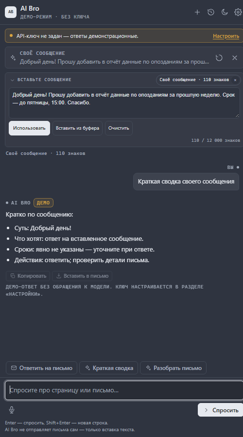
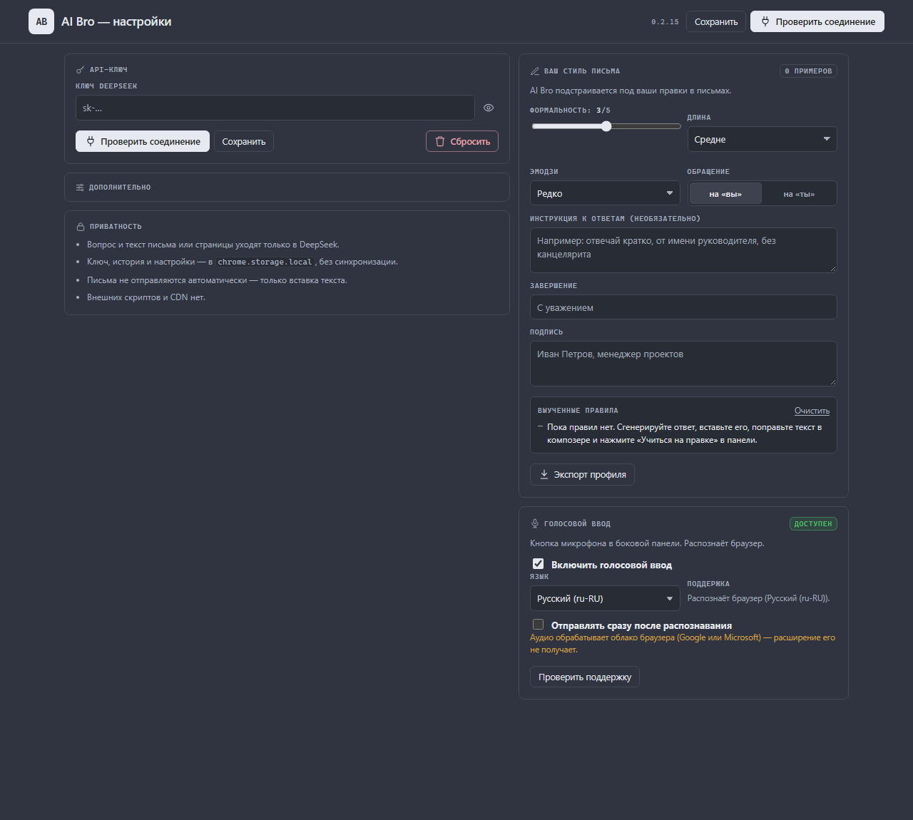

# AI Bro — AI-помощник в браузере

*Сводка проекта для разработки. Версия 0.2.15 · Chrome + Edge (Chromium / Manifest V3).*
**Продукт:** AI Bro (прежнее рабочее имя «Почерк»).
**Репозиторий:** <https://github.com/ganinnikita1/ai_ext>

Плагин, который живёт в боковой панели браузера и помогает писать: читает письмо или страницу,
предлагает три черновика ответа **вашим** стилем, учится на ваших правках — и никогда не нажимает
«Отправить». Работает в **Gmail, Outlook Web и Яндекс Почте**; обработка по умолчанию — **DeepSeek API**
(ключ BYOK хранится только в браузере, своего сервера нет).

> Статус: продуктовый концепт + техническая архитектура + рабочий скелет расширения готовы.
> UI переведён в визуальный стиль проекта **bb** ([get-bb/bb](https://github.com/get-bb/bb)) — монохромная
> IDE-эстетика, Inter + mono, hairline-бордеры, инвертированные кнопки, без градиентов.

---

## 1. Как это выглядит

**Ответ на письмо.** Открытое письмо → панель AI Bro: «Ответить на письмо», «Краткая сводка»,
«Разобрать письмо», «Разобрать всю переписку»; три черновика → «Вставить в письмо». Письмо не
отправляется: это всегда делаете вы.

**Своё сообщение.** В панели есть поле **«Вставьте сообщение»** — скопируйте письмо/фрагмент
переписки, нажмите «Использовать» (есть «Вставить из буфера»), и ответ/сводка/разбор строятся только
по этому тексту, без зависимости от вёрстки почты и всей страницы.



**Настройки.** Только API-ключ DeepSeek, профиль стиля и голос — без выбора модели/провайдера.



---

## 2. Функции

| # | Функция | Что делает | Этап |
|---|---|---|---|
| 1 | **Ответ на письмо** | читает открытый тред (Gmail, Outlook Web, Яндекс Почта и Яндекс 360), даёт 3 варианта с учётом тона отправителя и вашего стиля, вставляет в композер | MVP |
| 2 | **Чтение страницы** | по кнопке/хоткею извлекает основной текст активной вкладки, отвечает на вопросы, делает сводку, «что от меня хотят», «спорные места» | MVP |
| 3 | **Ваш стиль (Style Twin)** | профиль стиля (формальность, длина, приветствия, подпись, эмодзи) + обучение на **разнице** «AI-черновик → отправленный текст»; хранится локально | MVP (база) → v1 (обучение) |
| 4 | **Голосовой ввод** | наговорить ответ/диктовка/голосовые команды; Web Speech API в панели | v1 |
| 5 | **Рекомендации** | «ответить сейчас / подождать / позвонить / подготовить документ» с объяснением «почему» | v1 |
| 6 | **Цитаты-якоря** | ответ по странице со ссылками на абзацы: клик — подсветка абзаца | v2 |
| 7 | **DeepSeek (фиксировано)** | модель `deepseek-flash`, reasoning medium; пользователь вводит только API-ключ; demo-режим без ключа | MVP |
| 8 | **Честные ограничения в UI** | видно, что прочитано не полностью, какая модель отвечает, что уйдёт в облако | MVP |
| 9 | **Действия на почте** | «Ответить на письмо» (по открытому), «Краткая сводка» (3–5 пунктов), «Разобрать письмо» (подробно), «Разобрать всю переписку» (все отрисованные сообщения области чтения); без picker/выбора сообщения; сайдбары, списки и превью не читаются | MVP |
| 10 | **Своё сообщение** | поле «Вставьте сообщение» + «Вставить из буфера»: ответ/сводка/разбор только по вставленному тексту, страница/DOM не влияют; при пустом поле — авто-контекст открытого письма | MVP |

Правила продукта: **никаких автоотправок**, человек в цикле, явная маркировка AI-текста,
контент страниц — недоверенные данные (а не инструкции), минимум прав, «не учиться на моих письмах»
можно выключить.

---

## 3. Голос: как мы его «запихиваем»

Голос — не отдельный продукт, а второй способ ввода в тех же сценариях.

**Реализация (уже в скелете):**
1. Кнопка микрофона в панели → `SpeechRecognition` / `webkitSpeechRecognition` (Web Speech API).
2. Язык из настроек (`ru-RU` по умолчанию), `continuous` + промежуточные результаты — текст
   появляется по мере речи прямо в поле ввода.
3. Автостоп по тишине (≈2,6 с) и жёсткий лимит записи; повторный клик — стоп; «Отмена» выбрасывает всё.
4. Отказ в доступе к микрофону не блокирует продукт: понятное сообщение, остальное работает.
5. Ничего не пишется на диск: расширение не получает аудио, только текст от браузера.

**Важная деталь приватности:** в Chromium Web Speech API распознаёт **в облаке вендора** —
Google в Chrome, Microsoft в Edge. Аудио покидает устройство (расширение к нему доступа не имеет
и не хранит его). Это явно написано в настройках и README.

**Запасной путь (не в MVP):** `MediaRecorder` → собственный STT по BYOK (Whisper API) или локальный
Whisper — полный контроль над приватностью и языком, но дороже по разработке.

**Ограничения:** нужен интернет для облачного распознавания; в корпоративных политиках сервис может
быть отключён; панель должна быть открыта; Web Speech API нет в Firefox-сборке.

---

## 4. Читает ли он страницы самого Chrome/Edge

**Да — обычные веб-страницы и только по вашему действию.** Никакого фонового чтения вкладок и истории.

- Контент-скрипт внедряется **по кнопке/хоткею/контекстному меню** (activeTab + `chrome.scripting`),
  берёт DOM активной вкладки, вытаскивает основной текст (эвристика Readability-типа), режет до
  ~14 000 символов и отправляет в панель; туда же попадает выделенный фрагмент.
- Постоянный доступ — только к доменам веб-почты (Gmail, Outlook Web, Яндекс Почта): кнопка «Черновики»
  и чтение открытого письма. Яндекс Почта — best-effort: DOM у Яндекса меняется, поэтому есть fallback
  и «выделите текст вручную» (см. §5).
- Ограничения (честно показываем в UI): `chrome://`, `edge://`, `about:`, `chrome-extension://`,
  страницы магазинов расширений, встроенный PDF-просмотрщик, содержимое `<iframe>`, canvas/WebGL,
  закрытый Shadow DOM, текст, который подгружается только при прокрутке, поля паролей.
- Пейволлы/авторизация: прочитается только доступная часть — с пометкой.
- Очень длинные страницы: в MVP обрезка с флагом «прочитано частично», в бете — чанкинг/выжимка.

---

## 5. Как это устроено технически

```
 sidepanel.html/js  ──►  lib/llm-client.js  ──►  API провайдера (ключ пользователя)
        ▲                       │
        │ chrome.runtime        │
 background.js (service worker): меню, команды, инъекция, маршрутизация
        │ chrome.tabs.sendMessage
 content.js (страница, Gmail, Outlook Web, Яндекс Почта): извлечение текста/треда, вставка в композер
```

**Провайдер — DeepSeek API, модель и URL зафиксированы в коде.** Пользователь видит в настройках только
поле API-ключа — провайдера/модель/цены выбрать нельзя (это снимает поддержку и путаницу).

| Параметр | Значение |
|---|---|
| Base URL | `https://api.deepseek.com` |
| Модель | `deepseek-flash` (DeepSeek-V4.1-Flash), пользователю не показывается |
| Endpoint | `POST /chat/completions` (стриминг SSE — как у OpenAI) |
| Reasoning | `thinking: {type: "enabled"}` + `reasoning_effort: "high"` — качество важнее скорости; в thinking-режиме DeepSeek игнорирует temperature |
| Ключ | только поле «API-ключ» в настройках; хранится в `chrome.storage.local` |
| Проверка | `GET /models`; в UI показывается только «Соединение работает» — без баланса и без количества моделей |
| Цена (для команды, не для UI) | 1M токенов off-peak: input $0.15, output $0.6; типичный черновик ≈ $0.001 |

**Подключить за 2 шага:** создать ключ на `https://platform.deepseek.com/api_keys` → Настройки → вставить
ключ → «Проверить соединение» → «Сохранить». Демо-режим без ключа сохраняется.

**Разбор письма и переписки.** Если заполнено поле «Вставьте сообщение» — действия идут **только по
вставленному тексту** (это самый надёжный путь: не зависит от вёрстки 360/Gmail/Outlook). Если поле
пустое — панель читает **только область чтения (reading pane)**: открытое письмо — его тело,
отправителя/время из шапки, вложения. Правый сайдбар «Письма на тему», списки писем и
сниппеты/превью **игнорируются**. На почте две кнопки анализа:
- **«Ответить на письмо»** и **«Краткая сводка»** — по открытому письму (сводка: суть/что хотят/сроки/действия, 3–5 пунктов);
- **«Разобрать письмо»** — подробный разбор только открытого письма;
- **«Разобрать всю переписку»** — все сообщения, уже отрисованные в области чтения (даже если они ниже
  вьюпорта). Свёрнутые «Предыдущее письмо» и лениво подгружаемые сообщения недоступны, пока вы не
  нажмёте «Открыть всю переписку»/не прокрутите цепочку — расширение не разворачивает её само.
Выбора сообщения/picker больше нет. Отправитель и время берутся только из шапки открытого письма (не из
цитаты), вложения — точные имена из карточки; модель не выдумывает имена/файлы (анти-галлюцинации).
Модель: DeepSeek **flash** с `reasoning_effort: high` (качество важнее скорости). Цитаты старой переписки вычищаются, история отделена от выбранного/последнего —
модель не переотвечает на закрытые вопросы. Scope применяется ко всем действиям: ответ, сводка, вопросы.

**Яндекс Почта и Яндекс 360** (`mail.yandex.ru` и `mail.360.yandex.ru` — корпоративная почта, классический
BEM-UI, плюс зеркала). Поддержаны 8 доменов `mail.yandex.*` и 8 `mail.360.yandex.*` — всего **20 доменов
почты** в манифесте. Отдельного «яндекс-браузерного» билда не нужно: это те же сайты в Chromium.
Чтение треда — best-effort: для 360 адаптер сначала ищет классические `.mail-Message*` /
`.mail-Thread-Subject`, отбрасывает сниппеты списка и чистит цитаты/подписи, затем пробует React-эвристики.
Возможны degraded-режим и предложение выделить письмо вручную; вставка идёт в contenteditable композера
(если композер внутри iframe — копирование в буфер). Живой QA нужен на обоих интерфейсах.

- **Manifest V3**, один кодбейс на Chrome и Edge; UI — боковая панель (`side_panel` / `sidePanel API`,
  Chrome/Edge 114+; `sidePanel.open()` — 116+, есть фолбэк).
- **Разрешения по минимуму:** `storage`, `activeTab`, `scripting`, `sidePanel`, `contextMenus`;
  `host_permissions` пустой; опциональные хосты только для адреса провайдера.
- **BYOK:** адрес/модель/ключ вводит пользователь; ключ в `chrome.storage.local` (не sync), не логируется.
- **Нет remote code:** все скрипты локальные, нет CDN/eval, строгая CSP. Стор одобряет.
- **Защита от prompt injection:** контент страницы/письма оборачивается в блок с криптослучайным
  nonce, инструкции из него запрещены системным промптом, автоотправки нет в коде вообще.
- **Почему почта через DOM, а не API:** `gmail.readonly` / `gmail.compose` — restricted scopes,
  для публикации нужен OAuth verification + security assessment (CASA): недели и деньги.
  DOM даёт основную ценность для проверки гипотезы; Gmail API / Microsoft Graph — этап беты.

Подробности: [proposals/engineering/architecture.md](proposals/engineering/architecture.md)
(совместимость Chrome/Edge, формат сообщений, ошибки, приватность, чек-лист магазинов).

---

## 6. Что уже готово в репозитории

```
browser-ai-copilot/
├─ README.md                     ← этот файл
├─ docs/CHROME-WEB-STORE.md      ← как опубликовать в Chrome Web Store / Edge
├─ docs/store-listing.md         ← готовые тексты листинга, обоснование прав, data-use
├─ docs/privacy-policy.md        ← черновик политики конфиденциальности
├─ docs/store/                   ← скриншоты 1280×800 и promo tile 440×280
├─ proposals/inventor/concept.md ← продуктовый концепт (название, сценарии, UX, метрики, риски)
├─ proposals/engineering/architecture.md ← архитектура, приватность, интеграция с почтой
├─ proposals/engineering/code-review.md ← независимое ревью 0.2.8 (18 находок, severity)
├─ proposals/engineering/screenshots/ ← реальные снимки UI скелета
└─ extension/                    ← рабочий скелет, грузится как unpacked
   ├─ manifest.json              MV3, Chrome/Edge, side panel
   ├─ background.js              service worker: меню, команды, инъекция
   ├─ sidepanel.html/js/css      чат, 3 варианта ответа, вставка, микрофон, история, темы
   ├─ content.js                 извлечение страницы, Gmail/Outlook/Яндекс Почта, вставка в композер
   ├─ options.html/js/css        BYOK-настройки (DeepSeek по умолчанию), стиль, голос, проверка соединения
   ├─ lib/                       LLM-клиент (SSE, DeepSeek), промпты, demo-режим, стиль, конфиг
   ├─ icons/                     иконки 16/32/48/128
   ├─ package.ps1                сборка zip → dist/aibro-0.2.15.zip
   └─ README.md                  инструкция запуска и ограничения
```

Скелет умеет без ключа: демо-режим отвечает шаблонными, но осмысленными черновиками; с ключом —
стриминг от выбранного провайдера; чтение страницы и треда, вставка в композер, обучение на правке,
голосовой ввод, история чатов. Сборка: `extension/dist/aibro-0.2.15.zip`.

---

## 7. Как запустить сейчас (2 минуты)

**Chrome:** `chrome://extensions` → «Режим разработчика» → «Загрузить распакованное расширение» →
папка `extension` (или `dist`-zip распаковать). **Edge:** `edge://extensions` → «Режим разработчика» →
«Загрузить распакованное» → та же папка.

Дальше: открыть любую статью → иконка «AI Bro» / `Ctrl+Shift+Y` → «Объяснить страницу», или Gmail →
кнопка «Черновики» у треда. **Яндекс Почта:** открыть письмо на `mail.yandex.ru` или `mail.360.yandex.ru` → кнопка «AI Bro» /
`Ctrl+Shift+Y` → «Ответить на письмо» (если тред не распознан — выделить текст письма, откроется плашка).
Для реальных ответов — Настройки → провайдер **DeepSeek** + ключ (или остаться в демо).
Подробнее — [extension/README.md](extension/README.md).

**Пошаговая инструкция с чек-листом проверки** (установка, демо, DeepSeek, голос, Яндекс Почта,
что делать при ошибках) — [УСТАНОВКА-И-ПРОВЕРКА.md](УСТАНОВКА-И-ПРОВЕРКА.md).

Пересобрать zip: `pwsh -File .\extension\package.ps1` (если PowerShell блокирует скрипты —
`powershell.exe -ExecutionPolicy Bypass -File .\extension\package.ps1`).

---

## 8. План на время разработки

| Этап | Срок (оценка) | Что делаем | Критерий выхода |
|---|---|---|---|
| **MVP** | 2–3 недели | Gmail + Яндекс Почта (best-effort) + панель + кнопка у треда, 3 варианта, вставка без отправки, DeepSeek по умолчанию, базовый профиль стиля, demo-режим, diff «что изменил» | 20 тестеров; ≥35% черновиков вставлено; ≥20% без правок; p50 < 8 с; 0 автоотправок |
| **v1 (бета)** | +4–6 недель | Outlook Web, доводка Яндекс Почты по QA-фидбеку, обучение Style Twin, рекомендации, голос, локальная модель, публикация в Chrome Web Store и Edge Add-ons | 200 установок/нед; D7 ≥ 30%; правок на 15% меньше |
| **v2** | +2–3 месяца | цитаты-якоря, PDF-вьюер/OCR, Team-профили, TTS, RU/EN, синк профиля (opt-in) | D30 ≥ 20%; NPS ≥ 30 |

Что делаем **сейчас**: доводим MVP-вертикаль на Gmail и Яндекс Почте (реальный аккаунт — проверить
селекторы треда и композера), тестируем DOM на 2–3 версиях вёрстки, проверяем side panel и голос
на реальном Edge, готовим privacy policy и листинги. Открытые вопросы и бэклог до беты — в разделе 11
architecture.md.

---

## 9. Магазины, юридика, риски (коротко)

- **Chrome Web Store:** аккаунт $5, ревью обычно 1–4 недели; нужны privacy policy, data-use
  disclosure, обоснование каждого разрешения; MV3 и запрет remote code — скелет уже соответствует.
- **Edge Add-ons:** бесплатно, ревью 1–7 рабочих дней; Edge также ставит расширения из Chrome Web Store.
- **Почта:** работа через DOM не требует OAuth и не нарушает API-политику; автоотправок нет.
  Яндекс Почта — тот же подход, но селекторы менее стабильны (best-effort + fallback).
- **Риски:** галлюцинации (запрет новых обещаний в промпте, пометка «проверьте цифры»),
  prompt injection (обёртка данных + отсутствие инструментов), хрупкость вёрстки Gmail/Outlook/Яндекс Почты
  (несколько стратегий селекторов + fallback «выделите текст»), приватность (BYOK, локально, без бэкенда),
  зависимость от одного провайдера (DeepSeek упал/поднял цены → 2–3 запасных OpenAI-совместимых).
- **Бренд:** «AI Bro» — рабочее имя; юридическая проверка (Роспатент/USPTO, домены, листинги) не делалась,
  есть запасные варианты («Оттиск», «Ink Twin», «Двойник»).

---

## 10. Публикация в Chrome Web Store (коротко)

1. `extension\dist\aibro-0.2.15.zip` → кабинет <https://chrome.google.com/webstore/devconsole> (аккаунт $5).
2. Заполнить листинг: тексты и обоснование прав — [docs/store-listing.md](docs/store-listing.md); скриншоты
   1280×800 — [docs/store/](docs/store/); политика — [docs/privacy-policy.md](docs/privacy-policy.md)
   (опубликовать на GitHub Pages и вставить URL).
3. Privacy practices: single purpose, data-use disclosure (контент писем/страниц → DeepSeek; ключ/история
   локально), remote code = No, каждый permission объяснён.
4. Submit → ревью 1–4 недели; для теста у 20 человек можно **Unlisted**. Edge Add-ons — тот же zip,
   ревью 1–7 дней. Подробный чек-лист и типичные отказы — [docs/CHROME-WEB-STORE.md](docs/CHROME-WEB-STORE.md).

---

## 11. Что нужно решить (к тебе)

1. **Имя** — оставляем «AI Bro» или берём запасное? До листингов нужно проверить ТЗ и домены.
2. **Ключ DeepSeek** — у каждого пользователя свой (BYOK, бесплатно для нас) или общий ключ продукта
   с лимитами и Pro-кредитами? От этого зависит онбординг и биллинг.
3. **Тестеры** — 20 человек на MVP (Gmail + Яндекс Почта, письма/страницы, RU/EN). Нужен хотя бы один
   живой аккаунт Яндекс Почты для проверки селекторов.
4. **Приоритет** — Gmail и Яндекс Почта уже в MVP; Outlook Web — v1. Правильно?
5. **Позиционирование** — «пишет как вы» (наш ров) vs «быстрее отвечает» (проще продать, легче скопировать).
6. **Яндекс 360** — нужна ли корпоративная почта на кастомных доменах (она тоже открывается в веб-интерфейсе
   Яндекс Почты) или достаточно mail.yandex.ru?

---

## Документы

- Продуктовый концепт: [proposals/inventor/concept.md](proposals/inventor/concept.md)
- Техническая архитектура: [proposals/engineering/architecture.md](proposals/engineering/architecture.md)
- Скелет расширения: [extension/README.md](extension/README.md)
- UI-референс: [get-bb/bb](https://github.com/get-bb/bb)
- Командное ревью 0.2.9 (inventor + architect + reviewer): [proposals/engineering/team-review-0.2.9.md](proposals/engineering/team-review-0.2.9.md)
- Код-ревью 0.2.8/0.2.9: [proposals/engineering/code-review.md](proposals/engineering/code-review.md), [code-review-0.2.9.md](proposals/engineering/code-review-0.2.9.md)
- Публикация в Chrome Web Store: [docs/CHROME-WEB-STORE.md](docs/CHROME-WEB-STORE.md)
- Тексты листинга и обоснование прав: [docs/store-listing.md](docs/store-listing.md)
- Политика конфиденциальности (черновик): [docs/privacy-policy.md](docs/privacy-policy.md)
